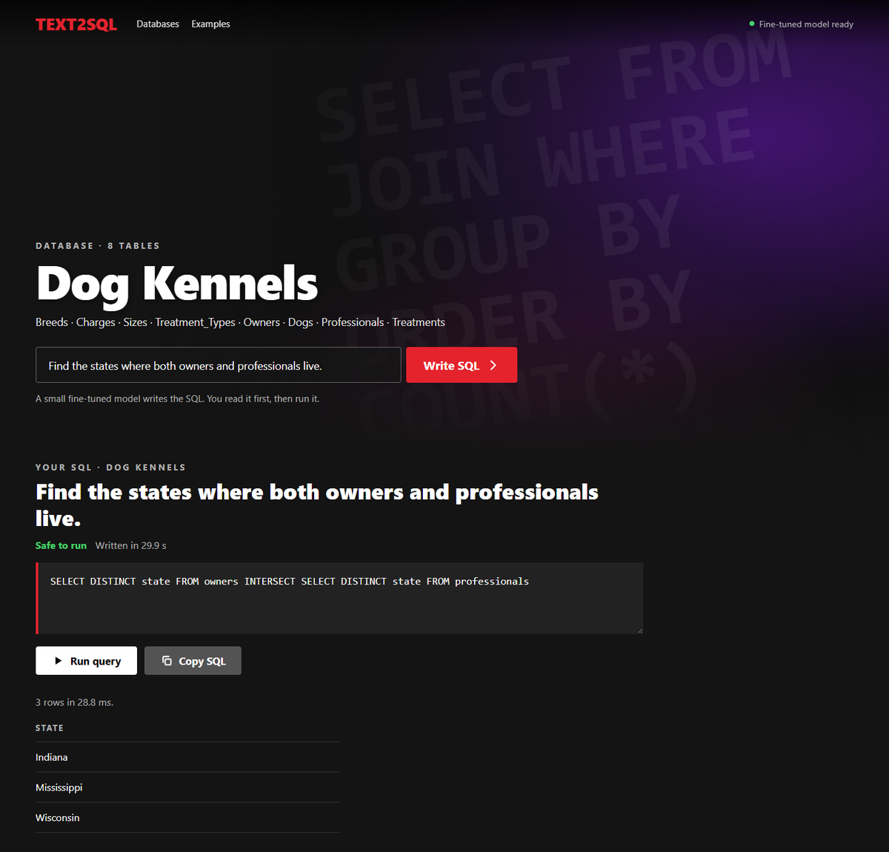
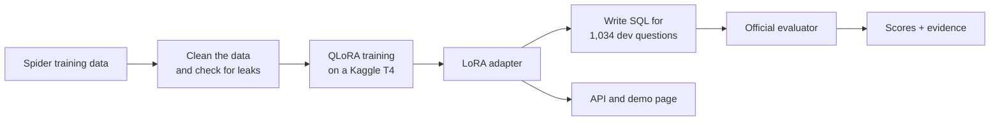
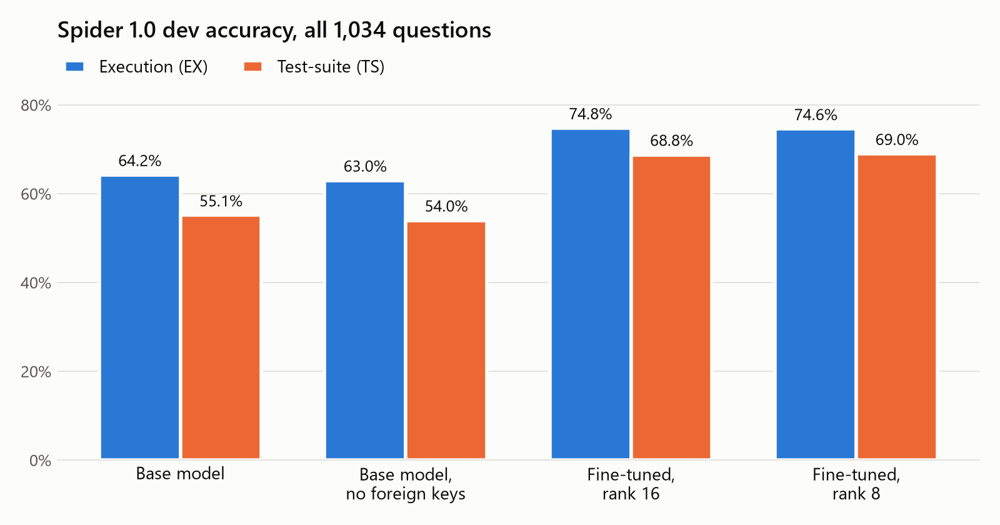

<div align="center">

# Text-to-SQL QLoRA Lab

**Ask questions about a database in plain English. Get SQL written by a small fine-tuned model, checked for safety before it runs, and scored with the official Spider evaluator.**

[](https://github.com/khoahonguyen0210/text2sql-qlora-lab/actions/workflows/ci.yml)


[](LICENSE)



</div>

```text
"Which region is the city Kabul located in?"
"How many models does each car maker produce? List maker full name, id and the number."
"Find the states where both owners and professionals live."
```

## Overview

Most data lives in databases, and getting answers out of a database means writing SQL. Many people who have questions about data cannot write it, and the large AI models that can are expensive to run.

Text-to-SQL QLoRA Lab fine-tunes a small open model, [Qwen2.5-Coder-1.5B-Instruct](https://huggingface.co/Qwen/Qwen2.5-Coder-1.5B-Instruct), to write SQL from a question and a database schema. Training uses QLoRA, so a full run fits on one free Kaggle GPU. Every score comes from the official Spider evaluator, and every run saves the settings, data hashes, and predictions behind it, so each number can be checked again.

The project uses [Spider 1.0](https://yale-lily.github.io/spider), a public benchmark of questions and SQL across 166 databases on topics such as concerts, flights, and pets. The model is trained on 146 of these databases and tested on 20 others that it never saw.

## Key Features

- **Ask in plain English** — Pick a database, type a question, and get SQL back with a safety check. The demo page can then run the SQL and show the rows.
- **Fair comparison** — The base model and the fine-tuned model use the same prompt, the same schema text, and the same decoding. Only the weights change.
- **Official scoring** — Scores come from the official Spider evaluator, pinned to one commit. Before any model is scored, the gold SQL itself is scored and must get 100%.
- **A stricter second score** — Each query is also run on many extra copies of each database, which catches queries that are right only by chance.
- **Low-cost training** — The base model is loaded in 4-bit, and only a small adapter is trained, so a full run takes about 2 hours on one T4 GPU.
- **Traceable runs** — Every run saves a manifest with the model revision, prompt hash, data hashes, settings, hardware, and timings.
- **Error analysis** — Wrong answers are labeled by error type, such as a wrong column or a wrong table, and two runs are compared question by question.
- **Safe SQL only** — The API accepts exactly one read-only `SELECT`, opens databases in read-only mode, and stops slow queries.

## How It Works



1. **The data is cleaned.** Exact duplicates are removed, and any training example that also appears in the dev set is dropped. Training and testing use different databases.
2. **A small adapter is trained.** The base model is loaded in 4-bit, and a LoRA adapter learns from the question, the schema written as `CREATE TABLE` statements, and the gold SQL.
3. **The model writes SQL.** For each of the 1,034 dev questions, the model writes one query with greedy decoding. If a run stops, it continues where it left off.
4. **The answers are scored.** The official evaluator runs each query and compares its rows with the rows of the gold query. Scoring runs on a CPU, so no GPU is needed.
5. **The errors are studied.** Each wrong answer gets an error label, and the base and fine-tuned runs are compared question by question.

The API uses the same prompt as the evaluation. You pick a database and ask a question, the model writes the SQL, and the SQL is checked before it can run on a read-only copy of the database.

## Results

<div align="center">



</div>

The model is scored on the Spider 1.0 dev set: 1,034 questions on 20 databases that it never saw in training. Execution accuracy (EX) checks that a query returns the same rows as the gold query. Test-suite accuracy (TS) runs the same check on many extra copies of each database, so it is stricter. Exact match (EM) checks that the query has the same parts as the gold query.

| Run | Execution (EX) | Test-suite (TS) | Exact match (EM) |
|---|---|---|---|
| Base model, no fine-tuning | 64.2% (664) | 55.1% (570) | 41.7% (431) |
| Base model, no foreign keys in the schema | 63.0% (651) | 54.0% (558) | 39.9% (413) |
| **Fine-tuned, rank 16** | **74.8% (773)** | **68.8% (711)** | **68.0% (703)** |
| Fine-tuned, rank 8 | 74.6% (771) | 69.0% (713) | 68.0% (703) |

| Other results | Value |
|---|---|
| Improvement from fine-tuning | **+10.6** EX points and **+13.7** TS points |
| Questions changed by fine-tuning | **160** fixed, **51** broken |
| Hardest questions (166 "extra hard") | **72** right before, **91** after |
| Rank 8 against rank 16 | Within **2** questions, with half the trained weights (9.2 M vs 18.5 M) |
| Leaving foreign keys out of the schema | **1.3** EX points lower for the base model |
| Training | **2.1 hours** on one T4 GPU, at most **12.1 GB** of GPU memory |
| Scoring check | Gold SQL scored **100%**, and every result matched the official tool |
| API on a laptop CPU | **22.7 s** median and **57.2 s** p95 per request, **0** of 100 failed |

These are dev scores, because the Spider test set is not public. Each setting was trained once, so small differences, such as rank 8 against rank 16, are not meaningful. The final checkpoint was always used, a rule set before training, so the dev set never chose a model. All predictions, scores, and manifests are in [`results/`](results/).

## Error Analysis

Fine-tuning helped at every difficulty level:

| Difficulty | Questions | Base model right | Fine-tuned right |
|---|---|---|---|
| Easy | 248 | 206 | **225** |
| Medium | 446 | 300 | **348** |
| Hard | 174 | 86 | **109** |
| Extra hard | 166 | 72 | **91** |

Most of the gain came from choosing the right columns and tables. Each wrong answer (by EX) gets one main error label:

| Main error | Base model | Fine-tuned |
|---|---|---|
| Wrong or missing column | 158 | **90** |
| Wrong table | 69 | **55** |
| Wrong filter value | 37 | **27** |
| `UNION`, `INTERSECT`, or `EXCEPT` | 34 | **17** |
| Grouping or aggregation | 25 | 30 |
| Nested query | 22 | 25 |
| Other | 25 | **17** |
| **Total wrong** | **370** | **261** |

Grouping and nested queries got slightly worse. The labels come from simple rules, so they are a guide, not an exact count. A sample of 50 wrong answers is in [`review.csv`](results/error_analysis/review.csv) for checking the labels by hand. The full summary is in [`summary.json`](results/error_analysis/summary.json).

## Technology Stack

| Component | Technology | Purpose |
|---|---|---|
| Model | Qwen2.5-Coder-1.5B-Instruct, PyTorch, Transformers | Writes SQL from a question and a schema |
| Fine-tuning | PEFT (LoRA), bitsandbytes (4-bit), Kaggle T4 GPU | Trains a small adapter at low cost |
| Evaluation | Official Spider evaluator, test-suite databases, NLTK | Computes EX, TS, and EM |
| SQL safety | sqlglot, SQLite (read-only) | Allows only one read-only `SELECT` |
| API and demo | FastAPI, Pydantic, Uvicorn, HTML, CSS, JavaScript | Serves the model and the demo page |
| Quality | GitHub Actions, pytest, Ruff, uv | Tests and linting on every push |

## Data

| Source | What it provides |
|---|---|
| [Spider 1.0](https://yale-lily.github.io/spider) | 8,659 training questions and 1,034 dev questions with gold SQL, across 166 databases |
| [Test-suite databases](https://github.com/taoyds/test-suite-sql-eval) | 695 extra database files for the 20 dev databases, filled with different data |
| [Qwen2.5-Coder-1.5B-Instruct](https://huggingface.co/Qwen/Qwen2.5-Coder-1.5B-Instruct) | The base model, pinned to one revision |

A request names a database and asks a question:

```json
{ "question": "Which region is the city Kabul located in?", "db_id": "world_1" }
```

The answer has the SQL, its safety check, and how long it took (part of a real response):

```json
{
  "db_id": "world_1",
  "sql": "SELECT DISTINCT T1.Region FROM country AS T1 JOIN city AS T2 ON T1.Code = T2.CountryCode WHERE T2.Name = \"Kabul\"",
  "status": "ok",
  "safety": { "ok": true, "reason": "" },
  "latency_ms": 32519.9,
  "prompt_tokens": 243,
  "completion_tokens": 35
}
```

### How the training data is built

| Step | Examples |
|---|---|
| Loaded from Spider | 8,659 |
| Exact duplicates removed | 42 |
| Removed because the same question and SQL are in the dev set | 2 |
| Final training set | 8,615 |
| Left out because they are longer than 1,536 tokens | 82 |
| Used in training | **8,533** |

## SQL Safety

SQL from the model or from a user must pass every check before it runs:

- **One read-only query** — The SQL must parse as exactly one `SELECT`, or a `UNION`, `INTERSECT`, or `EXCEPT` of them. Everything else is rejected.
- **Blocked twice** — Writes, `PRAGMA`, `ATTACH`, and file functions are blocked by the parser check, and again by an SQLite authorizer.
- **Read-only databases** — Database files open in read-only mode, and tests confirm that no file changes after scoring or after a blocked query.
- **Time and size limits** — Queries stop after 5 seconds and return at most 100 rows. Requests are limited in size and rate.
- **Nothing runs by itself** — Writing SQL and running SQL are two separate requests, so you can read the SQL before it runs.

## Checking the Scores

The saved predictions can be scored again on any computer, without a GPU. This takes about 3 minutes on a laptop CPU:

```bash
uv run python scripts/score.py results/runs/qlora-r16 --out artifacts/rescore/qlora-r16
```

Add `--db-set testsuite` for the TS score. A rescore of the saved fine-tuned run gave the same 773 of 1,034, with the same result for every question.

## Getting Started

### Prerequisites

- Python 3.12, [uv](https://docs.astral.sh/uv/), and Git
- About 10 GB of free disk space for the packages, the data, the test-suite databases, and the model
- About 8 GB of memory to run the model on a CPU
- A free [Kaggle](https://www.kaggle.com/) account, only if you want to train the model yourself

### 1. Clone the repository

```bash
git clone https://github.com/khoahonguyen0210/text2sql-qlora-lab.git
cd text2sql-qlora-lab
```

### 2. Install the packages

```bash
uv sync --extra model --extra serve --extra dev
uv run python scripts/fetch_evaluator.py
```

The second command downloads the official Spider evaluator at a pinned commit.

### 3. Download the data

Spider and the test-suite databases must be downloaded by hand, because Google Drive blocks scripted downloads. Get both files from the links in [`scripts/prepare_spider.py`](scripts/prepare_spider.py), and save them in `data/raw/` as `spider_data.zip` and `testsuitedatabases.zip`. Then run:

```bash
uv run python scripts/prepare_spider.py
uv run python scripts/build_data.py
```

### 4. Start the API

```bash
uv run python -m text2sql.serving --base
```

Open http://127.0.0.1:8000 and ask a question. The first start downloads about 3 GB of model weights from Hugging Face. `--base` serves the model without the adapter, because the adapter weights are not stored in this repository. To serve the fine-tuned model, train the adapter (step 5) and put it in `artifacts/runs/qlora-r16/adapter/`.

### 5. Train the model (optional)

You need a Kaggle API token in `~/.kaggle/kaggle.json`.

```bash
uv run python scripts/kaggle_bundle.py --user <your-kaggle-name>
```

This packs the code and data into a private Kaggle dataset, with one notebook folder per run, in `kaggle/bundle/`. Upload them with the Kaggle CLI, run the `qlora` notebook (about 2 hours), and download its output. Then score the run with `scripts/score.py`, and collect it into `results/` with `scripts/collect_results.py`.

## Testing

```bash
uv run ruff check src tests scripts kaggle
uv run pytest -q
uv run python scripts/check_harness.py
uv run python scripts/bench_api.py
```

There are 111 tests. They use small built-in databases, so they need no Spider data and no model. The scoring tests need the evaluator from step 2. CI runs Ruff and every test on each push. The scoring check (`check_harness.py`) takes about 25 minutes, and the latency test (`bench_api.py`) needs the trained adapter.

## API

| Method | Endpoint | Purpose |
|---|---|---|
| GET | `/` | Demo page: pick a database, ask a question, and run the SQL |
| GET | `/health`, `/ready` | Health checks |
| GET | `/v1/databases` | List the 20 dev databases and their tables |
| POST | `/v1/generate-sql` | Write SQL for a question and check it |
| POST | `/v1/run-sql` | Run one read-only `SELECT` and return up to 100 rows |

Full details are at http://127.0.0.1:8000/docs while the API is running.

## Configuration

Each run reads one settings file, and its manifest records which file it used.

| File | Purpose |
|---|---|
| `configs/base.toml` | The base model with no fine-tuning |
| `configs/base_nofk.toml` | The base model with no foreign keys in the schema |
| `configs/qlora.toml` | QLoRA training with rank 16 |
| `configs/qlora_r8.toml` | QLoRA training with rank 8 |
| `configs/serve.toml` | API settings: model, adapter path, databases, and limits |

## Project Structure

```text
src/text2sql/data/        Spider loading, schema text, and training data
src/text2sql/models/      Prompt, model loading, training, and generation
src/text2sql/evaluation/  Official evaluator wrapper, SQL extraction, and error labels
src/text2sql/serving/     FastAPI app and demo page
scripts/                  Data, training, generation, scoring, and analysis steps
configs/                  Settings for each run and for the API
kaggle/                   Kaggle notebook entry point
results/                  Scores, predictions, manifests, and error analysis
tests/                    Unit and API tests
docs/images/              README images
```

## Limitations

- Scores are for the Spider dev set only, with one training run per setting. Other databases and question styles may score lower.
- The model only sees the schema, not the data, so it can guess wrong filter values.
- The API serves one request at a time, and it is slow on a CPU. Latency was measured on one laptop (Intel i7-1260P, plugged in, Windows power mode "Best performance"), not on a GPU.
- The adapter weights are not stored here, so the fine-tuned model must be trained again to serve it.

## Security

The API has no user login, so it listens only on `127.0.0.1`. Keep it off the public internet. It collects no personal data, and questions and query results never leave your computer. Its only download is the model weights from Hugging Face, the first time it starts. Kaggle runs use a private dataset and private notebooks, and no keys are stored in this repository.

## Author

This is a personal project, built end to end by one person. Issues and suggestions are welcome.

| Name | Role | GitHub |
|---|---|---|
| Khoa Ho Nguyen | Author and maintainer | [@khoahonguyen0210](https://github.com/khoahonguyen0210) |

## License

MIT. See [`LICENSE`](LICENSE).

[`results/`](results/) contains questions and SQL from the Spider dev set, which is shared under [CC BY-SA 4.0](https://creativecommons.org/licenses/by-sa/4.0/). The base model, Qwen2.5-Coder-1.5B-Instruct, is shared under Apache 2.0.
